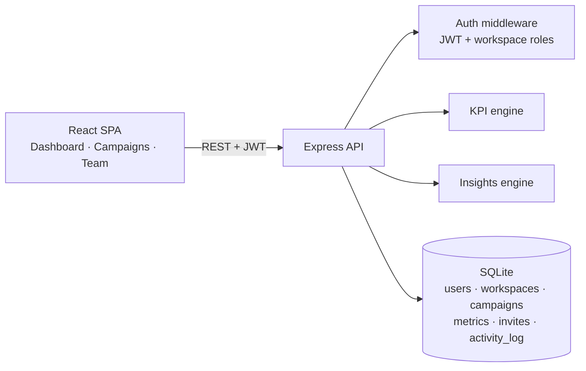

# CampaignHQ — Marketing Campaign Management & Analytics Platform

A full-stack platform for planning, tracking and analysing paid marketing campaigns across channels (Meta, Google, TikTok, LinkedIn, Email). Teams organise work in **workspaces**, log daily performance, import results from CSV, and get KPIs (CTR, CPC, CPM, CPA, ROAS, ROI) plus rule-based **insights** that flag wasted spend and scaling opportunities automatically.

Built with **React 19 + Vite** on the frontend and **Node.js (Express) + SQLite** on the backend, with JWT auth, role-based workspace membership and a full audit activity log.

## ✨ Features

- **Authentication & accounts** — register/login with hashed passwords (bcrypt) and JWT sessions; every account starts with a personal workspace
- **Workspaces & teams** — multiple workspaces per user, member roles (`owner` / `admin` / `member`), token-based invites, member management
- **Campaign management** — CRUD with channels, statuses (draft/active/paused/completed), budgets, target CPA and date ranges; search, filter, sort and pagination
- **Metrics tracking** — daily performance rows (impressions, clicks, spend, conversions, revenue) with upsert-by-date semantics
- **CSV import** — bulk-import daily metrics exported from ad platforms; invalid rows are reported, valid rows are imported transactionally
- **KPI engine** — CTR, CPC, CPM, CPA, ROAS, ROI and conversion rate computed server-side with zero-division guards
- **Dashboard analytics** — workspace totals, channel breakdown, spend-vs-revenue trend, top campaigns by ROAS, budget pacing meters
- **Insights engine** — rule-based findings: CPA above target, budget nearly exhausted, CTR too low for the impression volume, zero conversions with high clicks, stale data on active campaigns, strong-ROAS scaling candidates
- **Activity log** — an audit trail of workspace events (campaigns created, metrics imported, members invited…)

## 🧱 Tech stack

| Layer | Technology |
|---|---|
| Frontend | React 19, React Router 7, Vite 6, hand-rolled SVG charts (no chart library) |
| Backend | Node.js, Express 4 |
| Auth | JSON Web Tokens, bcryptjs password hashing |
| Database | SQLite via Node's built-in `node:sqlite` (WAL mode, foreign keys, unique constraints) — zero native dependencies |
| Testing | Node's built-in test runner — unit tests for the KPI/CSV/insights logic + end-to-end HTTP API tests |

## 🏗️ Architecture



```
campaignhq/
├── client/                 # Vite + React frontend
│   └── src/
│       ├── pages/          # Login/Register, Dashboard, Campaigns, Campaign detail, Team
│       ├── components/     # Layout, SVG charts
│       └── api.js          # JWT-aware API client
├── server/                 # Express API
│   ├── src/
│   │   ├── routes/         # auth, workspaces, campaigns (+metrics), analytics
│   │   ├── middleware/     # requireAuth, requireWorkspace, requireCampaign
│   │   ├── utils/          # kpi.js (KPIs + CSV), insights.js (rule engine)
│   │   ├── db.js           # schema + connection
│   │   └── seed.js         # demo account + 4 campaigns + 30 days of metrics
│   └── tests/              # unit + end-to-end API tests
└── package.json            # convenience scripts
```

## 🚀 Quick start

Prerequisites: Node.js 22.5+ (Node 24 LTS recommended — the API uses the built-in `node:sqlite` module).

```bash
# 1. Install dependencies
cd server && npm install
cd ../client && npm install
cd ..

# 2. Seed demo data (demo account, workspace, 4 campaigns, 30 days of metrics)
npm run seed

# 3. Run the API (http://localhost:4000)
npm start

# 4. In a second terminal, run the frontend (http://localhost:5173)
npm run dev:client
```

**Demo login:** `demo@campaignhq.app` / `demo1234` — or register your own account.

## 📡 API overview

| Method | Endpoint | Description |
|---|---|---|
| POST | `/api/auth/register` | Create account (+ personal workspace) |
| POST | `/api/auth/login` | Log in, returns JWT |
| GET | `/api/auth/me` | Current user |
| GET/POST | `/api/workspaces` | List / create workspaces |
| GET | `/api/workspaces/:id/members` | Members + pending invites |
| POST | `/api/workspaces/:id/invites` | Invite by email (admin+) |
| POST | `/api/workspaces/invites/accept` | Accept an invite token |
| GET | `/api/workspaces/:id/activity` | Workspace audit log |
| GET/POST | `/api/workspaces/:id/campaigns` | List (search/filter/sort/page) / create |
| GET/PATCH/DELETE | `/api/campaigns/:id` | Read / update / delete a campaign |
| GET/POST | `/api/campaigns/:id/metrics` | List / upsert daily metrics |
| POST | `/api/campaigns/:id/metrics/import` | Bulk CSV import |
| GET | `/api/campaigns/:id/analytics` | KPIs, daily series, insights |
| GET | `/api/workspaces/:id/dashboard` | Totals, channels, top campaigns, insights |

## ✅ Testing

```bash
npm test
```

Runs the KPI/CSV/insights unit tests plus an end-to-end suite that boots the API on an in-memory database and exercises the full register → workspace → campaign → metrics → analytics flow over HTTP.

## 🔐 Configuration

| Variable | Default | Purpose |
|---|---|---|
| `PORT` | `4000` | API port |
| `DB_PATH` | `server/data/campaignhq.db` | SQLite file location |
| `JWT_SECRET` | dev placeholder | **Set a real secret in production** |

## 🗺️ Roadmap

- Scheduled platform connectors (Meta/Google Ads API sync)
- Budget alerts via email when pacing thresholds are crossed
- Multi-currency workspaces and per-channel target profiles
- Exportable PDF/CSV performance reports

## 📄 License

MIT
